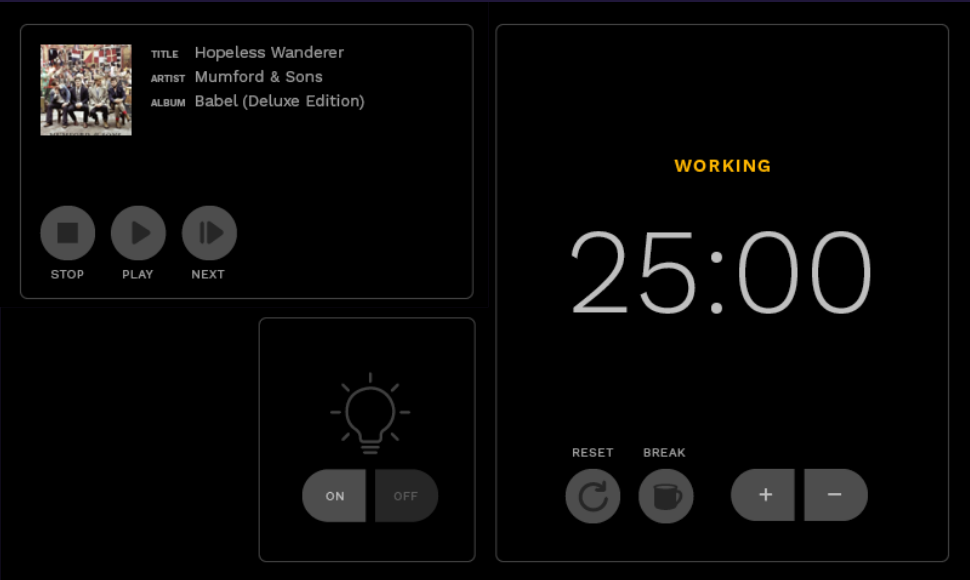
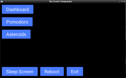
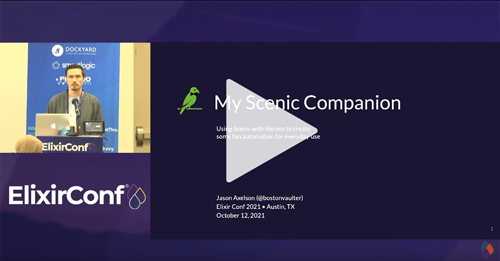

Top-level app that runs multiple scenic apps underneath. Uses a launcher application written in Scenic.

TODO:
- Get sleep all working on all the screens that I use
  - Probably need to hook into launcher so that it can take a first crack at keyboard events

Main Dashboard:

Launcher:

Check the following directories for detailed instructions on running the projects:
* [`ui/`](./ui) - Run via scenic on the desktop
* [`fw/`](./fw) - Run on a Nerves device with a touchscreen
  * Official Raspberry PI touch screen is supported

I spoke about this project a ElixirConf 2021, watch the video on YouTube:

Sub-application Repos:
- https://github.com/axelson/piano_ex
- https://github.com/axelson/pomodoro
- https://github.com/axelson/govee
- https://github.com/axelson/govee_phx
- https://github.com/axelson/govee_semaphore
- https://github.com/axelson/scenic_launcher
- https://github.com/axelson/scenic_asteroids

Troubleshooting:
- `mkdir _build/rpi3_dev/lib/play/static`

TODO:
- [ ] Expose LiveDashboard (protect via BasicAuth)
- [x] Ensure that all the deps are up to date
- [x] Get 192.168.1.6 to provide links
  - Currently it just says that no backend matched
- [x] Remove reliance and mentions of `dotenv`
- [x] Write example code for RpiFbCapture
- [x] Ensure there's instructions for copying `.target.secret.example.exs`
- [ ] Use HTTPS transparently
  - https://security.stackexchange.com/questions/121163/how-do-i-run-proper-https-on-an-internal-network
  - https://jsavoie.github.io/2021/06/01/letsencrypt.html
